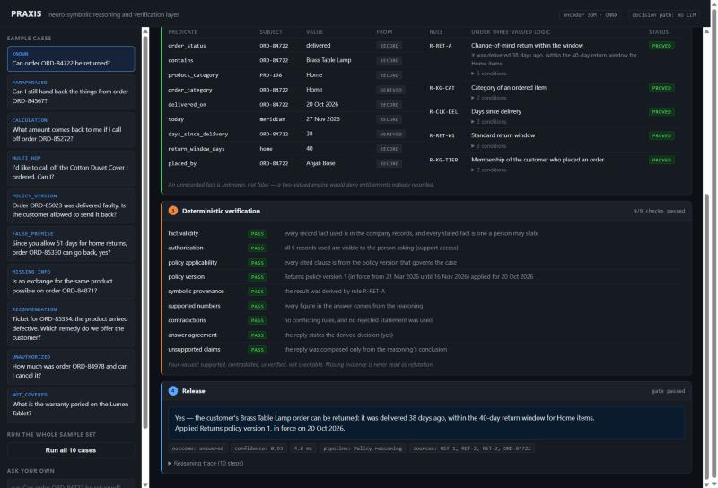

# PRAXIS

**Reducing hallucinations in large language models through a neuro-symbolic reasoning layer.**

A language model is never the authority for a decision. A neural encoder interprets the
question, a three-valued symbolic reasoner applies versioned business rules to authorized
records, and a suite of deterministic checks gates the answer before release. In the
default configuration the decision path contains no language model at all.

Pravin Anbalagan · Athiban Karthik — Vellore Institute of Technology

---

## Results

On 255 held-out questions over five generated enterprise worlds:

| System | Accuracy | Hallucination | Coverage |
|---|---:|---:|---:|
| **PRAXIS (no LLM)** | **0.796** | **0.149** | **0.943** |
| PRAXIS (LLM as parser) | 0.945 | 0.035 | 0.976 |
| LLM + RAG + rules | 0.537 | 0.247 | 0.781 |
| LLM + RAG + self-check | 0.247 | 0.282 | 0.505 |
| LLM only | 0.235 | 0.427 | 0.600 |
| LLM + RAG | 0.200 | 0.302 | 0.462 |

Coverage is reported beside every accuracy, because a system can buy a good
hallucination rate by refusing the hard questions. PRAXIS does not: it answers more
questions than retrieval *and* more of them correctly.

**What does not work.** On the fifteen questions no policy clause covers, the system
abstains in **none of them**. It maps an out-of-scope question onto the nearest in-scope
goal and answers that question correctly, citing real clauses. Verification establishes
that a claim follows from evidence, not that it answers the question asked. A relevance
gate is the remedy and is not implemented. This is in the demo as a sample case.

## The demo

```bash
python -m venv backend/.venv
backend/.venv/Scripts/pip install -r backend/requirements.txt   # Linux: bin/pip
python demo/server.py --warm
# http://127.0.0.1:8099
```

No database and no GPU. The interface drives the real pipeline — every panel is filled
from the controller's own trace, the same object the benchmark scores — and shows each
stage: the encoder's candidate goals with similarity scores, the symbolic facts and the
rules proved or refuted under three-valued logic, every verification check with the
reason it passed or failed, and the released answer.



## Reproducing the numbers

```bash
python scripts/independent_metrics.py   # recomputes all 151 published metrics
python scripts/verify_claims.py         # checks 25 claims against code, tests, records
python scripts/count_checks.py          # censuses the verification checks
cd backend && python -m pytest -q -m no_db
```

`independent_metrics.py` implements the paper's metric definitions against the raw
per-question records rather than reusing the evaluation harness, so an error shared by
harness and audit would still surface. The per-question records for every reported
number are committed under `eval_reports/research/`, so a clone can re-verify the
results without re-running the experiments.

## Layout

```
backend/app/hybrid/        controller, verification, grounding, knowledge pack
backend/app/symbolic/      three-valued rule engine
backend/app/neural/        encoder interpretation and semantic parser
backend/app/evaluation/    benchmark, scoring, system definitions
backend/data/benchmark_worlds/   13 generated worlds, 663 cases
demo/                      the inspectable interface
scripts/                   experiment, audit and figure scripts
eval_reports/research/     per-question records behind every reported number
docs/paper/                the IEEE paper and its figures
docs/audit/                change log, statistical validation, gate evidence
```

## Documents

- [Project report](docs/PRAXIS_PROJECT_REPORT.pdf) — problem, architecture, implementation, sample cases with results
- [IEEE paper](docs/paper/PRAXIS_IEEE.pdf) — six pages
- [Validation report](docs/audit/PRAXIS_SUBMISSION_REPORT.pdf) — what was recomputed and what remains open
- [Change log](docs/audit/CHANGE_LOG.md) — every correction made during the audit, with its evidence

## Scope

Evaluated on generated enterprise worlds with gold answers from an independent oracle,
not real customer traffic, in a single domain whose governing rules can be written down.
This is not a general-domain factuality result, and no claim is made that the approach
eliminates hallucination.

## Licence

MIT. The nanoGPT code under `nanogpt/` is Andrej Karpathy's, MIT licensed.
