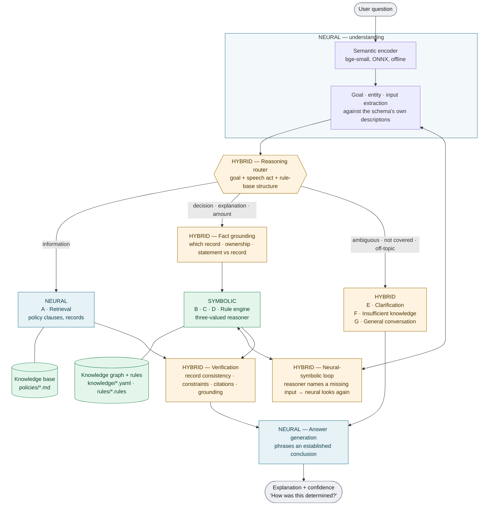

# Praxis: neuro-symbolic decision intelligence

> **Research question.** Does adding symbolic reasoning and verification reduce
> hallucinated or unsupported enterprise decisions, compared with LLM and RAG baselines?
>
> **Product.** The *Support Decision Copilot*, a trustworthy AI decision copilot for
> customer-service operations. See [PRODUCT.md](PRODUCT.md) for positioning, the
> commercial model and the expansion plan.

This document describes the system, why each part exists, and what the measurements show.
That includes where the system fails and which comparisons have not been run yet.

**The principle.** Neural AI understands the situation the person describes. Symbolic AI
decides what the enterprise's rules imply. A language model is never the authority for a
business decision, and a decision that fails verification is not released.

The demonstration company, **Meridian Marketplace**, is fictional. Everything about it
lives in one directory, [`backend/data/meridian`](../backend/data/meridian); no module
under `backend/app` names a Meridian concept.

---

## 1. Architecture



| Layer | Code | Responsibility |
|---|---|---|
| **NEURAL** | [`app/neural`](../backend/app/neural) | encoder, intent detection, entity & input extraction, semantic retrieval, answer phrasing |
| **SYMBOLIC** | [`app/symbolic`](../backend/app/symbolic) | rule language, knowledge graph, three-valued reasoner, typed rendering |
| **HYBRID** | [`app/hybrid`](../backend/app/hybrid) | router, fact grounding, neural-symbolic loop, verification, trace, API service |
| **Knowledge** | [`data/meridian`](../backend/data/meridian) | policies, rules, company graph, benchmark |
| **Evaluation** | [`app/evaluation/ns_benchmark.py`](../backend/app/evaluation/ns_benchmark.py) | systems, metrics, reports |
| **UI** | [`frontend/src/components/ReasoningPanel.tsx`](../frontend/src/components/ReasoningPanel.tsx) | status, sources, "How was this determined?" |

### The Support Decision Copilot layer

The verticalized product adds these capabilities to the same pipeline. Each one lives
where the architecture says it should.

| Capability | Layer | Where |
|---|---|---|
| Authorization before reasoning: the reasoner receives an *authorized view* of the graph, declared with `access` statements | SECURITY → SYMBOLIC | [`knowledge_graph.py`](../backend/app/symbolic/knowledge_graph.py) `AuthorizedGraph` |
| Policy versioning: `version returns_policy(order) of returns on delivery_date` resolves the version in force on the case's own date | SYMBOLIC | [`reasoner.py`](../backend/app/symbolic/reasoner.py) `_resolve_version`, [`retrieval.py`](../backend/app/neural/retrieval.py) |
| Recommended resolution, approval escalation, goodwill exceptions, routing — composed from the customer policies in the playbook's order | SYMBOLIC | [`04_support.rules`](../backend/data/meridian/rules/04_support.rules) |
| Follow-ups: a goal whose result qualifies another's action (`followup recommended_resolution approval_required`) | HYBRID | controller |
| Claims about the policy ("the policy is 30 days") checked against the parameters the proof read | HYBRID | [`claims.py`](../backend/app/hybrid/claims.py) |
| Verified inputs: claims only a record can confirm ("the manager approved it") | HYBRID | grounding, reasoner (closed world) |
| Ten-check verification with a release gate | HYBRID | [`verification.py`](../backend/app/hybrid/verification.py) |
| Knowledge-gap classification | HYBRID | [`gaps.py`](../backend/app/hybrid/gaps.py) |
| Recommended actions and decision labels, authored with the policy (`action`, `label`) | SYMBOLIC data | [`01_schema.rules`](../backend/data/meridian/rules/01_schema.rules) |
| Knowledge administration: validate against the whole pack, snapshot, apply, restore | HYBRID | [`knowledge_store.py`](../backend/app/hybrid/knowledge_store.py), [`copilot.py`](../backend/app/api/routers/copilot.py) |

The demonstration, generated from real runs by `scripts/demo_copilot.py`, is in
[demo/DEMO.md](demo/DEMO.md).

---

## 2. Where standard RAG ends and neuro-symbolic reasoning begins

```
question → embed → retrieve policy clauses → ─┐
                                              │  standard RAG stops here:
                                              │  hand the clauses to a model and let it
                                              │  write something that sounds right
                                              ▼
            ┌───────────── neuro-symbolic reasoning begins ─────────────┐
            resolve the record  →  validate what the person said against it
            →  evaluate the rules on the record  →  find the violated condition
            →  compute the amount  →  verify  →  phrase the conclusion
```

Pipeline **A** *is* retrieval, and is used when that is the right answer — "what is the
leave policy?" Every other pipeline uses retrieval only to **cite**. The decision is made
by rules evaluated over records; no language model sees the question while it is made.

A retrieval system can return the clause *"Electronics have a 10-day window"*. It cannot
determine that *your* earbuds, delivered 25 days ago, are outside it — that requires
the delivery date from a record, arithmetic, and a comparison. That gap is the system.

---

## 3. The components, and why each exists

For each: why neural, why symbolic, why combined, and what it buys over an LLM alone.

### 3.1 Understanding the question — NEURAL, symbolically validated

**Why neural.** "I don't want this anymore, can I give it back?" shares no content word
with *"whether an item that was bought can be sent back to the seller"*. Only a model
that encodes meaning connects them. The encoder maps the question onto the **goals
declared in the rule files** — there is no intent list and no example question anywhere.

**Why symbolic too.** Embeddings encode *topic*, not *form*. Measured on the development
set, they classified what kind of answer was wanted correctly **8 times in 27**;
interrogative-form grammar ("why…", "how much…") did it **25 times in 27**. Symbolic
checks also reject interpretations that cannot be right: a question with no content word
selects no goal, and a goal's kind must fit the request — a "how much" question prefers
a calculation goal even when an eligibility goal scores 0.02 higher.

**Why combined.** Meaning from the network, validity from rules about language and about
the schema.

**Over an LLM alone.** An LLM also understands paraphrase — better than this 33M-parameter
encoder. The difference is that here understanding produces a *hypothesis* (goal,
record, stated facts) that is then checked, instead of flowing straight into an answer.

### 3.2 The reasoning router — HYBRID

**Why.** Neuro-symbolic does not mean every question goes through a rule engine. The
router selects:

| Pipeline | When | Example |
|---|---|---|
| **A** Retrieval | asks what policy says, or for a record's status | "What is the leave policy?" · "Where is my order?" |
| **B** Policy reasoning | a yes/no decision the rules determine | "Can I cancel order 12345?" |
| **C** Multi-hop | why an outcome happened | "Why was my refund rejected?" |
| **D** Calculation | an amount | "How much will I be reimbursed for ₹8,750?" |
| **E** Clarification | several goals or records fit | "Can I cancel it?" (two orders) |
| **F** Insufficient | a company question nothing in the knowledge covers | "What is the noise limit for a delivery van?" |
| **G** General conversation | not a company question at all | "Who won the 2018 World Cup?" |

**F and G are different failures.** F is a knowledge gap: the question is about the
company, the pack does not cover it, and the honest answer names what is missing and
logs the gap for an administrator. G is not a gap at all — no policy anyone could write
would answer it — so the language model answers it as an ordinary assistant would, with
no citation, no verification and an explicit label saying the answer is its own
knowledge rather than anything this company recorded. The test for G is lexical and
drawn from the pack itself: if none of the question's content words appear in the
company's policies, goal descriptions or schema, no goal match can be anything but an
artefact of embedding distance. One shared word is enough to stay in the company
pipeline, so paraphrases the encoder should handle are never diverted.

It decides from the question **and the structure of the rule base**: a goal whose rules
compute a value needs calculation; a goal concluded by rules needs symbolic evaluation;
a lookup needs neither. Every answer records the pipeline and the reason in its trace.

### 3.3 Knowledge representation — SYMBOLIC

Company knowledge is written as logic in a readable rule language
([`rules/*.rules`](../backend/data/meridian/rules)) and compiled through the validated
rule grammar, so every rule is checked when it is written: head variables bound,
comparisons bound first, negation stratified, **every rule citing the policy clause it
encodes**.

```
rule R-RET-A "Change-of-mind return within the window" [RET-1, RET-2, RET-3]
  if   order_status(?o) = "delivered"
  and  order_category(?o) = ?c
  and  not non_returnable(?c)                         otherwise "{c} items cannot be returned for change of mind"
  and  days_since_delivery(?o) = ?d
  and  effective_return_window(?o) = ?w
  and  ?d <= ?w                                       otherwise "it was delivered {d} days ago, past the {w}-day return window"
  then return_allowed(?o) = true
  because "it was delivered {d} days ago, within the {w}-day return window for {c} items"
end
```

The same files declare what the neural layer reads:

```
goal  return_allowed(order) decision "whether an item that was bought can be sent back to the seller"
input return_reason(order) -> enum damaged_on_arrival "the product arrived broken, cracked, smashed, damaged, faulty or defective"
relevant return_allowed when order_status(?x) = "delivered"
```

The **knowledge graph** ([`knowledge/company.yaml`](../backend/data/meridian/knowledge/company.yaml))
holds customers, orders, products, categories, payments, returns, refunds, employees and
claims. Entity-valued attributes are edges, so a rule reaches *refund → return → order →
product → category → return window*. Every policy **number** lives on the company node;
rules hold only logic.

**Adding a policy is a data change.** Write the clause, write rules citing it, declare
the goal. The assistant understands questions about it immediately — no code, no
retraining, no example questions.

### 3.4 Three-valued reasoning — SYMBOLIC

**Why.** A classical rule engine treats a missing fact as false. That is precisely why
rule-based chatbots answer "no" or "out of my reach" to questions they could handle.
[`reasoner.py`](../backend/app/symbolic/reasoner.py) keeps three outcomes apart:

| | Meaning | Yields |
|---|---|---|
| satisfied | the knowledge proves it | a decision |
| **violated** | the knowledge refutes it | **why-not**: "delivered 25 days ago, past the 10-day window" |
| **unknown** | nobody has stated what it depends on | **missing information** and **conditional answers** |

So *"How much will I be reimbursed if my trip cost ₹8,750?"* without a record returns
**₹8,000 if you travelled by public transport; the lower of ₹8,000 and ₹9 per km if you
drove — provided the trip was at least 50 km, you have receipts, and you submit within
30 days.** An unknown inside arithmetic stays symbolic rather than being guessed.

Company records are a **closed world** a user's statement cannot override. A described
case is an **open world**. A conditionally derived value that disagrees with a condition
makes it unknown, never violated — a soundness fix found by running the specification's
own example questions.

### 3.5 Fact grounding — HYBRID

The neural layer says *"this is about the shoes"* and *"they said two weeks ago"*.
Grounding decides what is true:

- **Which record.** An id is validated against the graph and against **ownership** — a
  customer cannot reason over another customer's order. "My order" is narrowed by the
  goal's declared relevance and by consistency with what was said: *"I ordered this two
  weeks ago"* resolves to the one order delivered 14 days ago. Still ambiguous → ask.
- **Misleading information.** *"Order 12346 was delivered 60 days ago"* when the record
  says 14: reported, and the record used.
- **New cases.** A description that fits none of the person's records is reasoned about
  as a hypothetical linked to them, so their grade and membership still apply.

### 3.6 The neural-symbolic loop — HYBRID

When the reasoner reports an input it lacks, the neural layer is asked to look again
**for exactly that input**, with the lower threshold that knowing what to look for
justifies, and the reasoner re-evaluates. The trace records each round.

### 3.7 Verification — HYBRID, and a release gate

Every check is deterministic.

1. **Fact validity.** Every record fact used is in the records with that value, and every
   stated fact is one a person may state.
2. **Authorization.** Every record the proof touched is visible to the person asking.
3. **Policy applicability.** Every cited clause is from the policy version that governs the
   case.
4. **Policy version.** The version applied was in force on the case's date.
5. **Symbolic provenance.** The decision came from a rule or a declared default.
6. **Calculation.** An amount re-derives to the same value from scratch, and is valid and
   non-negative.
7. **Supported numbers.** Every figure in the reply appears in the conclusion.
8. **Contradictions.** No conflict between rules of equal priority, the stored outcome
   agrees with the derived one, and no rejected statement was used.
9. **Answer agreement.** The reply's decision matches the symbolic result (a "no" is never
   phrased as a "yes").
10. **Unsupported claims.** A model's rephrasing adds no sentence the conclusion doesn't
    support.

Checks that don't apply are omitted; a yes/no decision has no calculation to re-derive. If
a model's phrasing fails, the deterministic phrasing is used and re-verified. If a check of
the reasoning itself fails, the answer is **withheld**: the outcome becomes `needs_review`,
no decision is stated, and a `verification_failure` gap is logged.

### 3.7a Claims, versions and gaps — HYBRID

- **False premises.**
  - *Policy claims:* a number the person attributes to the policy is never bound to the
    case. After reasoning, it is compared with the policy parameters the proof actually
    read, e.g. `damage_report_days(RETURNS-v2) = 15`. A mismatch is corrected in the
    answer and cites the version.
  - *Verified inputs:* approvals and other claims only a record can confirm. On a real
    record, "no record" means no; they are never assumed.
- **Policy versions.**
  - Each version is a node with an effective date and its own parameters.
  - Superseded clauses stay citeable, so a case governed by version 1 cites version 1, but
    they are never retrieved as current policy.
  - A general question with no date is answered under the version in force today, and the
    trace records that this was assumed.
- **Knowledge gaps.** Each unanswerable question is classified by which structure was
  missing:
  - *no goal or clause* → `uncovered_topic`;
  - *a decision table over one input that matches no declared value* → `undefined_case`;
  - *a rule condition whose policy parameter was never recorded* →
    `missing_policy_parameter`;
  - *a failed check* → `verification_failure`.

  Gaps appear on the answer, and are aggregated for administrators by type and summary.

### 3.8 Generation — NEURAL, after the decision

Generation receives an established conclusion and phrases it. With no model configured,
a deterministic realizer composes the reply from the conclusion's fields. With a model
configured, the model rephrases it, and the result is discarded if it introduces any
figure the conclusion does not contain. **It is never asked what the answer is.**

### 3.9 Explanation — every answer

The trace records `neural_interpretation`, `entities`, `retrieved_knowledge`,
`symbolic_facts` (with source: record / stated / derived), `rules_used`,
`rules_considered` (with the violated condition), `reasoning_steps`,
`neural_symbolic_loop`, `verification`, `selected_pipeline`, `pipeline_reason` and
`confidence` with its factors. None of it is model free-text: there is no hidden
chain-of-thought, because no step of the decision is a model reasoning in prose.

---

## 4. Hallucination prevention, point by point

| Requirement | Mechanism |
|---|---|
| Source grounding | Sources are the clauses cited by the rules that decided the answer |
| Rule validation | Rules compile through a validated grammar; uncited rules are rejected |
| Fact verification | Statements are checked against records; records win |
| Contradiction detection | Stored outcome vs derived decision; statement vs record |
| Confidence estimation | Deterministic blend of understanding, determinacy, support, verification |
| Missing-information detection | Unknown leaves of the three-valued evaluation |
| Knowledge freshness | Policies carry an effective date; the graph pins "today" |
| Deterministic calculations | Rule arithmetic; unknowns stay symbolic |
| Symbolic validation of interpretations | Content-word and goal-kind checks in the router |
| Never invent policy, prices, eligibility, refunds | The generator only phrases conclusions; grounding rejects new figures |
| Policy versioning | The version in force on the case's date; superseded text is not retrieved as current |
| Misleading user premises | Policy claims compared with parameters; approvals only from records |
| Access control | The reasoner sees an authorized view; the verifier checks nothing outside it was used |
| Output verification | Ten checks; failing answers withheld as `needs_review` |

---

## 5. Evaluation

### Method

The systems run on the same questions, knowledge and users
([`ns_benchmark.py`](../backend/app/evaluation/ns_benchmark.py)).

| System | Description |
|---|---|
| **llm_only** *(baseline 1)* | A language model with the person's identity and today's date, and no company knowledge |
| **llm_rag** *(baseline 2)* | Adds retrieval over every policy document (superseded versions included, as a document index holds them) and the records the person may see |
| **llm_rag_rules** *(baseline 3)* | The model extracts a goal, record and facts as JSON. A *basic* rule engine then decides with the same rules: two-valued (unknown = false), newest version always, statements accepted as given, no grounding, claim checks or verification. The model phrases the result |
| **neurosymbolic** *(proposed)* | The full system, with the deterministic realizer |
| **neurosymbolic_lexical** | Ablation: the semantic encoder replaced by lexical hashing |
| **rag_extractive** | Retrieval answered by quoting what was retrieved |

Each case is scored by rule from its expectations:
- final answer, decision, calculation and rule-execution accuracy;
- policy compliance: no forbidden content, no wrong definite decision, no definite answer
  to an unanswerable question;
- intent, record resolution, pipeline selection, retrieval and explanation correctness;
- hallucination and unsupported-answer rates, and latency.

The language-model baselines run against any hosted provider (`LLM_PROVIDER=openai` with a
base URL, key and model), or against an open-weights model on the local GPU
(`LLM_PROVIDER=local`). When neither is configured they are reported as not run, never
simulated.

Three data sets, kept apart:

| Set | Cases | Use |
|---|---|---|
| [`dev.yaml`](../backend/data/meridian/benchmark/dev.yaml) | 27 | calibrating thresholds only |
| [`test.yaml`](../backend/data/meridian/benchmark/test.yaml) | 86 | **committed before its first run** (git `a7800ea`) |
| [`holdout.yaml`](../backend/data/meridian/benchmark/holdout.yaml) | 40 | written after the test runs, **committed before its only run** |
| [`copilot.yaml`](../backend/data/meridian/benchmark/copilot.yaml) | 53 | support-copilot questions in the nine specified categories (known, paraphrased, unseen, multi-hop, policy, calculation, conflicting-policy, missing-information, adversarial), **committed before its first run** (git `5b9a329`) |

All ten requested categories are covered: known, paraphrased, unseen, multi-condition,
multi-hop, ambiguous, calculation, missing information, misleading information,
symbolic rules.

### Results

**Run 1 — frozen test set, first run** ([report](benchmark/run1-frozen-test.md))

| Metric | neurosymbolic | lexical ablation | extractive RAG |
|---|---|---|---|
| Final answer accuracy | **0.744** | 0.093 | 0.105 |
| Rule execution accuracy | **0.811** | 0.000 | 0.000 |
| Intent accuracy | 0.818 | 0.052 | n/a |
| Record resolution | 0.863 | 0.000 | n/a |
| Pipeline selection | 0.877 | 0.099 | n/a |
| Hallucination rate | 0.116 | 0.000 | 0.012 |

**Run 2 — same test set after fixes, post-hoc** ([report](benchmark/run2-posthoc-test.md)).
Accuracy 0.779, hallucination 0.081, unsupported answers 0.000. *Not an unbiased
estimate*: the fixes were informed by run 1's failures.

**Run 3 — hold-out set, single run** ([report](benchmark/run3-holdout.md))

| Metric | neurosymbolic | lexical ablation | extractive RAG |
|---|---|---|---|
| Final answer accuracy | **0.800** | 0.125 | 0.150 |
| Rule execution accuracy | **0.840** | 0.000 | 0.000 |
| Record resolution | **0.941** | 0.000 | n/a |
| Pipeline selection | 0.850 | 0.250 | n/a |
| Hallucination rate | 0.025 as scored — **0.05 in substance** (see below) | 0.000 | 0.000 |

**Run 4 — copilot set, frozen, first run** ([report](benchmark/run4-copilot-frozen.md))

| Metric | neurosymbolic | lexical ablation | extractive RAG |
|---|---|---|---|
| Final answer accuracy | **0.642** | 0.038 | 0.038 |
| Decision accuracy | **0.720** | 0.000 | 0.000 |
| Calculation accuracy | **0.750** | 0.000 | 0.000 |
| Policy compliance | 0.906 | 1.000 | 0.962 |
| Pipeline selection | 1.000 | 0.000 | n/a |
| Hallucination rate | 0.094 | 0.000 | 0.038 |
| Unsupported-answer rate | 0.000 | n/a | 0.000 |

By category, the full system scored:
- unseen support requests 0.86, known 0.83, calculation 0.80;
- adversarial 0.67 and policy 0.67;
- conflicting-policy 0.50, multi-hop 0.50, and paraphrased 0.17.

The ablations score 1.000 on policy compliance because they almost never commit to an
answer. Compliance has to be read together with accuracy.

Run 4 exposed three genuine soundness bugs, not just misreadings:
- An approval nobody recorded was treated as *unknown* rather than *absent*, producing a
  provisional goodwill credit.
- A number stated about the policy ("the window is 60 days") was bound to the case as its
  delivery age.
- A comparison that fails under every rule that could supply a value was reported as
  undecided.

**Run 5 — copilot set after those fixes, post-hoc** ([report](benchmark/run5-copilot-posthoc.md)):

| Metric | Run 4 | Run 5 |
|---|---|---|
| Final answer accuracy | 0.642 | 0.774 |
| Decision accuracy | 0.720 | 0.840 |
| Calculation accuracy | 0.750 | 0.833 |
| Policy compliance | 0.906 | 0.925 |
| Hallucination rate | 0.094 | 0.075 |
| Unsupported-answer rate | 0.000 | 0.000 |

All three fixes are general, and none targets a question's wording. They were still
prompted by this set's failures, so run 5 is not an unseen estimate.

**Runs 6 and 7 — the earlier sets on the versioned knowledge pack, post-hoc**
([test](benchmark/run6-test-v2pack.md), [hold-out](benchmark/run7-holdout-v2pack.md)).

| Split | Final answer accuracy | Hallucination rate |
|---|---|---|
| Test | 0.756 | 0.081 |
| Hold-out | 0.825 | 0.025 |

Two test cases were written for the pre-versioning pack:
- **M01** expects a "7-day" mention, but returns policy version 2 now governs that order.
- **I03** expects a conditional answer, but the policy gives a definite no: the shoes were
  delivered 14 days ago, past version 1's 7-day damage window.

The files were not edited; both cases count as failures.

### Not yet run: the language-model baselines

`llm_only`, `llm_rag` and `llm_rag_rules` are implemented, but none has produced a result
yet:
- no hosted-provider key is configured on this machine;
- the local open-weights model (Qwen2.5-1.5B-Instruct, 3.1 GB) could not be downloaded
  here: the connection to Hugging Face ran at about 24 KB/s.

**So the central comparison with LLM and RAG baselines is not measured in this
repository yet.** The results above compare the full system with its lexical ablation and
with retrieval alone. To complete it:

```bash
# hosted (e.g. a free Groq key)
LLM_PROVIDER=openai LLM_BASE_URL=https://api.groq.com/openai/v1 LLM_API_KEY=... \
LLM_MODEL=llama-3.3-70b-versatile python scripts/run_ns_benchmark.py --split copilot
# or locally, once the model is downloaded (needs torch + transformers, ~6 GB GPU)
LLM_PROVIDER=local python scripts/run_ns_benchmark.py --split copilot
python scripts/demo_copilot.py        # the four-system demonstration, same configuration
```

Report the first run of that command as the frozen result: the copilot set was fixed
before any of these systems ran on it.

### What the results show

**1. Neural understanding is necessary.** Replacing the encoder with lexical matching
drops accuracy from 0.80 to 0.13. Paraphrase and unseen questions go to zero.

**2. Symbolic reasoning is necessary.** Extractive RAG retrieves the expected clause in
7 of 8 test cases and 3 of 3 hold-out cases that name one, and still decides **no** case
correctly: it can quote the window, not apply it to a delivery date.

**3. The failures are upstream of the rules.** Wrong answers trace to the neural layer
misreading the question — *"am I too late?"* read as delivery lateness, *"refund turned
down"* as a cancellation refund, *"referral bonus"* matched to leave eligibility — or to
an extraction miss. Measured precisely: where the goal was identified correctly and a
decision or amount was expected, the decision was correct in **41 of 41** test cases
(runs 1 and 2) and **21 of 22** hold-out cases. The one exception, HS4, is also an
extraction failure: "groceries" did not link to the category *Grocery*, so the case was
left undecided rather than decided wrongly. The symbolic half is reliable; accuracy is
bounded by understanding and extraction.

**4. The architecture turns uncertainty into questions.** On ambiguous questions,
accuracy was 0.71 (run 1), 0.86 (run 2) and 1.00 (hold-out); the system asks which order
rather than guessing.

### What the results do not show

- **No comparison against a real LLM yet.** See "Not yet run" above. **Without it, the
  central research question is only partly answered.**
- **No business-outcome measurements.** Handle time, first-contact resolution, escalation
  and satisfaction need a pilot with agents; the protocol is in
  [PILOT_STUDY_PROTOCOL.md](PILOT_STUDY_PROTOCOL.md). The console reports only what is
  measured from real traffic: share verified, withheld, clarified, not covered and
  escalated, premises rejected, and latency.
- **One author.** The same person wrote the knowledge pack and all three question sets,
  and the hold-out set was written knowing run 1's failure modes. An independently
  written set is the proper next step.
- **Small sets.** 86 and 40 cases; category-level rates rest on 3–10 cases each.
- **Disclosed scorer gap.** The scorer flags *definite* answers to out-of-scope questions
  as hallucinations, but not *conditional* ones. Hold-out case HI3 ("do you price match
  competitors?") received a conditional answer about an unrelated replacement: a
  hallucination in substance, not counted. Counting it, the hold-out rate is 2/40.
- **Small encoder.** bge-small (33M parameters) was chosen to run offline. Measured on
  non-test words, single-word product linking cannot be thresholded safely ("pillow" →
  bedsheet scores 0.73, above "trainers" → shoes at 0.67), so "sneakers", "tea" and
  "nuts" do not link.

---

## 6. Known limitations

- **Understanding is the bottleneck.** A larger encoder, or an LLM producing structured
  interpretations that the existing symbolic checks validate, is the obvious next step.
  The architecture accommodates it: understanding only has to emit goal, records and
  stated inputs.
- **The knowledge pack is hand-authored.** Rules are written by a person from policy
  text. Extracting candidate rules from new policy documents for human review is future
  work.
- **One item per order.** Orders contain a single product in the demo graph.
- **The graph lives in files.** Administrators edit it through a validated,
  snapshotted store on a Docker volume, per deployment. Production use would load records
  from operational systems (orders, CRM, HR) with the same row-level tenant isolation as
  the rest of the platform.
- **Staff hypotheticals have no customer.** A support agent's general case ("my customer's
  laptop…") has no membership tier. Rules that depend on it stay conditional, and the
  order total is taken as the product's list price (stated in the reasons).
- **Paraphrase remains the weakest category** (0.33 on the copilot set after fixes).
- **English only.** The interrogative-form grammar is English.

---

## 7. Running it

```bash
docker compose up -d --build            # model downloaded at build time; runs offline
```

Open http://localhost:8080. Password for every demo account: `Praxis-Demo-2026!`

| Account | Who | Try |
|---|---|---|
| `priya@meridian.test` | Meridian Plus customer, Bengaluru | "My package arrived damaged. Can I get a replacement?" |
| `sam@meridian.test` | Standard customer, Pune | "How much will I get back if I cancel order 22003?" |
| `dev@meridian.test` | Employee, grade L2, 4.5 years | "How much will I be reimbursed if my trip cost ₹8,750?" |
| `ana@meridian.test` | Employee, grade L1, 1.3 years | "Why am I not eligible for the higher annual leave?" |
| `rohan@meridian.test` | Standard customer, Mumbai; one order under each returns policy version | "My laptop arrived damaged. Can I get a replacement?" |
| `support@meridian.test` | Support agent | "My customer's laptop arrived damaged 12 days ago and they want a replacement. What can I offer?" |
| `admin@meridian.test` | Knowledge administrator | Sidebar → **Knowledge & reliability** |

```bash
cd backend && python -m pytest -q                      # full suite
python scripts/run_ns_benchmark.py                     # test set, all systems
python scripts/run_ns_benchmark.py --split holdout     # hold-out set
python scripts/run_ns_benchmark.py --split copilot     # Support Decision Copilot set
python scripts/demo_copilot.py                         # four-system demonstration -> docs/demo/DEMO.md
```

Administrative changes persist in the `praxis-knowledge` Docker volume. To reset to the
pack in the repository, run `docker volume rm praxisvit_praxis-knowledge` and bring the
stack up again.
