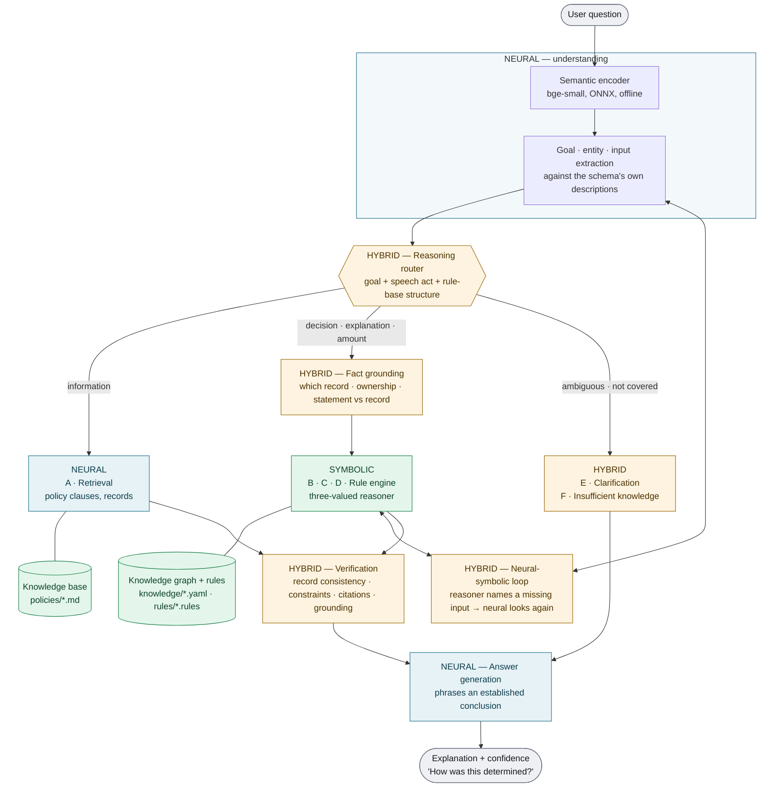

# Neuro-symbolic enterprise assistant

> **Research question.** Can combining neural language understanding with symbolic
> knowledge and rule-based reasoning produce a more accurate, explainable and reliable
> enterprise chatbot than a conventional LLM/RAG system?

This document describes the system built to test that question, why each part exists,
and what the measurements show — including where the system fails.

The demonstration company, **Meridian Marketplace**, is fictional. Everything about it
lives in one directory, [`backend/data/meridian`](../backend/data/meridian); no module
under `backend/app` names a Meridian concept.

---

## 1. Architecture



| Layer | Code | Responsibility |
|---|---|---|
| **NEURAL** | [`app/neural`](../backend/app/neural) | encoder, intent detection, entity & input extraction, semantic retrieval, answer phrasing |
| **SYMBOLIC** | [`app/symbolic`](../backend/app/symbolic) | rule language, knowledge graph, three-valued reasoner, typed rendering |
| **HYBRID** | [`app/hybrid`](../backend/app/hybrid) | router, fact grounding, neural-symbolic loop, verification, trace, API service |
| **Knowledge** | [`data/meridian`](../backend/data/meridian) | policies, rules, company graph, benchmark |
| **Evaluation** | [`app/evaluation/ns_benchmark.py`](../backend/app/evaluation/ns_benchmark.py) | systems, metrics, reports |
| **UI** | [`frontend/src/components/ReasoningPanel.tsx`](../frontend/src/components/ReasoningPanel.tsx) | status, sources, "How was this determined?" |

---

## 2. Where standard RAG ends and neuro-symbolic reasoning begins

```
question → embed → retrieve policy clauses → ─┐
                                              │  standard RAG stops here:
                                              │  hand the clauses to a model and let it
                                              │  write something that sounds right
                                              ▼
            ┌───────────── neuro-symbolic reasoning begins ─────────────┐
            resolve the record  →  validate what the person said against it
            →  evaluate the rules on the record  →  find the violated condition
            →  compute the amount  →  verify  →  phrase the conclusion
```

Pipeline **A** *is* retrieval, and is used when that is the right answer — "what is the
leave policy?" Every other pipeline uses retrieval only to **cite**. The decision is made
by rules evaluated over records; no language model sees the question while it is made.

A retrieval system can return the clause *"Electronics have a 10-day window"*. It cannot
determine that *your* earbuds, delivered 25 days ago, are outside it — that requires
the delivery date from a record, arithmetic, and a comparison. That gap is the system.

---

## 3. The components, and why each exists

For each: why neural, why symbolic, why combined, and what it buys over an LLM alone.

### 3.1 Understanding the question — NEURAL, symbolically validated

**Why neural.** "I don't want this anymore, can I give it back?" shares no content word
with *"whether an item that was bought can be sent back to the seller"*. Only a model
that encodes meaning connects them. The encoder maps the question onto the **goals
declared in the rule files** — there is no intent list and no example question anywhere.

**Why symbolic too.** Embeddings encode *topic*, not *form*. Measured on the development
set, they classified what kind of answer was wanted correctly **8 times in 27**;
interrogative-form grammar ("why…", "how much…") did it **25 times in 27**. Symbolic
checks also reject interpretations that cannot be right: a question with no content word
selects no goal, and a goal's kind must fit the request — a "how much" question prefers
a calculation goal even when an eligibility goal scores 0.02 higher.

**Why combined.** Meaning from the network, validity from rules about language and about
the schema.

**Over an LLM alone.** An LLM also understands paraphrase — better than this 33M-parameter
encoder. The difference is that here understanding produces a *hypothesis* (goal,
record, stated facts) that is then checked, instead of flowing straight into an answer.

### 3.2 The reasoning router — HYBRID

**Why.** Neuro-symbolic does not mean every question goes through a rule engine. The
router selects:

| Pipeline | When | Example |
|---|---|---|
| **A** Retrieval | asks what policy says, or for a record's status | "What is the leave policy?" · "Where is my order?" |
| **B** Policy reasoning | a yes/no decision the rules determine | "Can I cancel order 12345?" |
| **C** Multi-hop | why an outcome happened | "Why was my refund rejected?" |
| **D** Calculation | an amount | "How much will I be reimbursed for ₹8,750?" |
| **E** Clarification | several goals or records fit | "Can I cancel it?" (two orders) |
| **F** Insufficient | nothing in the knowledge covers it | "What is the capital of France?" |

It decides from the question **and the structure of the rule base**: a goal whose rules
compute a value needs calculation; a goal concluded by rules needs symbolic evaluation;
a lookup needs neither. Every answer records the pipeline and the reason in its trace.

### 3.3 Knowledge representation — SYMBOLIC

Company knowledge is written as logic in a readable rule language
([`rules/*.rules`](../backend/data/meridian/rules)) and compiled through the validated
rule grammar, so every rule is checked when it is written: head variables bound,
comparisons bound first, negation stratified, **every rule citing the policy clause it
encodes**.

```
rule R-RET-A "Change-of-mind return within the window" [RET-1, RET-2, RET-3]
  if   order_status(?o) = "delivered"
  and  order_category(?o) = ?c
  and  not non_returnable(?c)                         otherwise "{c} items cannot be returned for change of mind"
  and  days_since_delivery(?o) = ?d
  and  effective_return_window(?o) = ?w
  and  ?d <= ?w                                       otherwise "it was delivered {d} days ago, past the {w}-day return window"
  then return_allowed(?o) = true
  because "it was delivered {d} days ago, within the {w}-day return window for {c} items"
end
```

The same files declare what the neural layer reads:

```
goal  return_allowed(order) decision "whether an item that was bought can be sent back to the seller"
input return_reason(order) -> enum damaged_on_arrival "the product arrived broken, cracked, smashed, damaged, faulty or defective"
relevant return_allowed when order_status(?x) = "delivered"
```

The **knowledge graph** ([`knowledge/company.yaml`](../backend/data/meridian/knowledge/company.yaml))
holds customers, orders, products, categories, payments, returns, refunds, employees and
claims. Entity-valued attributes are edges, so a rule reaches *refund → return → order →
product → category → return window*. Every policy **number** lives on the company node;
rules hold only logic.

**Adding a policy is a data change.** Write the clause, write rules citing it, declare
the goal. The assistant understands questions about it immediately — no code, no
retraining, no example questions.

### 3.4 Three-valued reasoning — SYMBOLIC

**Why.** A classical rule engine treats a missing fact as false. That is precisely why
rule-based chatbots answer "no" or "out of my reach" to questions they could handle.
[`reasoner.py`](../backend/app/symbolic/reasoner.py) keeps three outcomes apart:

| | Meaning | Yields |
|---|---|---|
| satisfied | the knowledge proves it | a decision |
| **violated** | the knowledge refutes it | **why-not**: "delivered 25 days ago, past the 10-day window" |
| **unknown** | nobody has stated what it depends on | **missing information** and **conditional answers** |

So *"How much will I be reimbursed if my trip cost ₹8,750?"* without a record returns
**₹8,000 if you travelled by public transport; the lower of ₹8,000 and ₹9 per km if you
drove — provided the trip was at least 50 km, you have receipts, and you submit within
30 days.** An unknown inside arithmetic stays symbolic rather than being guessed.

Company records are a **closed world** a user's statement cannot override. A described
case is an **open world**. A conditionally derived value that disagrees with a condition
makes it unknown, never violated — a soundness fix found by running the specification's
own example questions.

### 3.5 Fact grounding — HYBRID

The neural layer says *"this is about the shoes"* and *"they said two weeks ago"*.
Grounding decides what is true:

- **Which record.** An id is validated against the graph and against **ownership** — a
  customer cannot reason over another customer's order. "My order" is narrowed by the
  goal's declared relevance and by consistency with what was said: *"I ordered this two
  weeks ago"* resolves to the one order delivered 14 days ago. Still ambiguous → ask.
- **Misleading information.** *"Order 12346 was delivered 60 days ago"* when the record
  says 14: reported, and the record used.
- **New cases.** A description that fits none of the person's records is reasoned about
  as a hypothetical linked to them, so their grade and membership still apply.

### 3.6 The neural-symbolic loop — HYBRID

When the reasoner reports an input it lacks, the neural layer is asked to look again
**for exactly that input**, with the lower threshold that knowing what to look for
justifies, and the reasoner re-evaluates. The trace records each round.

### 3.7 Verification — HYBRID

1. **Record consistency** — a stored outcome (refund *rejected*) must agree with the
   derived decision, or the disagreement is surfaced.
2. **Constraints** — an amount must be a finite, non-negative number.
3. **Citation integrity** — every clause a rule cites exists.
4. **Answer grounding** — every figure in the reply appears in the conclusion.

### 3.8 Generation — NEURAL, after the decision

Generation receives an established conclusion and phrases it. With no model configured,
a deterministic realizer composes the reply from the conclusion's fields. With a model
configured, the model rephrases it, and the result is discarded if it introduces any
figure the conclusion does not contain. **It is never asked what the answer is.**

### 3.9 Explanation — every answer

The trace records `neural_interpretation`, `entities`, `retrieved_knowledge`,
`symbolic_facts` (with source: record / stated / derived), `rules_used`,
`rules_considered` (with the violated condition), `reasoning_steps`,
`neural_symbolic_loop`, `verification`, `selected_pipeline`, `pipeline_reason` and
`confidence` with its factors. None of it is model free-text: there is no hidden
chain-of-thought, because no step of the decision is a model reasoning in prose.

---

## 4. Hallucination prevention, point by point

| Requirement | Mechanism |
|---|---|
| Source grounding | Sources are the clauses cited by the rules that decided the answer |
| Rule validation | Rules compile through a validated grammar; uncited rules are rejected |
| Fact verification | Statements are checked against records; records win |
| Contradiction detection | Stored outcome vs derived decision; statement vs record |
| Confidence estimation | Deterministic blend of understanding, determinacy, support, verification |
| Missing-information detection | Unknown leaves of the three-valued evaluation |
| Knowledge freshness | Policies carry an effective date; the graph pins "today" |
| Deterministic calculations | Rule arithmetic; unknowns stay symbolic |
| Symbolic validation of interpretations | Content-word and goal-kind checks in the router |
| Never invent policy, prices, eligibility, refunds | The generator only phrases conclusions; grounding rejects new figures |

---

## 5. Evaluation

### Method

Four systems on the same questions, knowledge and users
([`ns_benchmark.py`](../backend/app/evaluation/ns_benchmark.py)):

- **neurosymbolic** — the full system
- **neurosymbolic_lexical** — ablation: the semantic encoder replaced by lexical hashing
- **rag_extractive** — retrieval over the same policy text and the person's own records,
  answered with what was retrieved
- **llm_rag** — the same retrieval with a real model writing the answer

Scored by rule from each case's expectations: intent, record resolution, pipeline
selection, rule execution, retrieval, explanation correctness, hallucination,
unsupported answers, latency.

Three data sets, kept apart:

| Set | Cases | Use |
|---|---|---|
| [`dev.yaml`](../backend/data/meridian/benchmark/dev.yaml) | 27 | calibrating thresholds only |
| [`test.yaml`](../backend/data/meridian/benchmark/test.yaml) | 86 | **committed before its first run** (git `a7800ea`) |
| [`holdout.yaml`](../backend/data/meridian/benchmark/holdout.yaml) | 40 | written after the test runs, **committed before its only run** |

All ten requested categories are covered: known, paraphrased, unseen, multi-condition,
multi-hop, ambiguous, calculation, missing information, misleading information,
symbolic rules.

### Results

**Run 1 — frozen test set, first run** ([report](benchmark/run1-frozen-test.md))

| Metric | neurosymbolic | lexical ablation | extractive RAG |
|---|---|---|---|
| Final answer accuracy | **0.744** | 0.093 | 0.105 |
| Rule execution accuracy | **0.811** | 0.000 | 0.000 |
| Intent accuracy | 0.818 | 0.052 | n/a |
| Record resolution | 0.863 | 0.000 | n/a |
| Pipeline selection | 0.877 | 0.099 | n/a |
| Hallucination rate | 0.116 | 0.000 | 0.012 |

**Run 2 — same test set after fixes, post-hoc** ([report](benchmark/run2-posthoc-test.md)).
Accuracy 0.779, hallucination 0.081, unsupported answers 0.000. *Not an unbiased
estimate*: the fixes were informed by run 1's failures.

**Run 3 — hold-out set, single run** ([report](benchmark/run3-holdout.md))

| Metric | neurosymbolic | lexical ablation | extractive RAG |
|---|---|---|---|
| Final answer accuracy | **0.800** | 0.125 | 0.150 |
| Rule execution accuracy | **0.840** | 0.000 | 0.000 |
| Record resolution | **0.941** | 0.000 | n/a |
| Pipeline selection | 0.850 | 0.250 | n/a |
| Hallucination rate | 0.025 as scored — **0.05 in substance** (see below) | 0.000 | 0.000 |

### What the results show

**1. Neural understanding is necessary.** Replacing the encoder with lexical matching
drops accuracy from 0.80 to 0.13. Paraphrase and unseen questions go to zero.

**2. Symbolic reasoning is necessary.** Extractive RAG retrieves the expected clause in
7 of 8 test cases and 3 of 3 hold-out cases that name one, and still decides **no** case
correctly: it can quote the window, not apply it to a delivery date.

**3. The failures are upstream of the rules.** Wrong answers trace to the neural layer
misreading the question — *"am I too late?"* read as delivery lateness, *"refund turned
down"* as a cancellation refund, *"referral bonus"* matched to leave eligibility — or to
an extraction miss. Measured precisely: where the goal was identified correctly and a
decision or amount was expected, the decision was correct in **41 of 41** test cases
(runs 1 and 2) and **21 of 22** hold-out cases. The one exception, HS4, is also an
extraction failure: "groceries" did not link to the category *Grocery*, so the case was
left undecided rather than decided wrongly. The symbolic half is reliable; accuracy is
bounded by understanding and extraction.

**4. The architecture turns uncertainty into questions.** On ambiguous questions,
accuracy was 0.71 (run 1), 0.86 (run 2) and 1.00 (hold-out); the system asks which order
rather than guessing.

### What the results do not show

- **No comparison against a real LLM.** `llm_rag` did not run: no model key was
  configured, and it is reported as not run rather than simulated. **Without it, the
  research question is only partly answered.** The extractive RAG baseline shows what
  retrieval alone cannot do; it does not show what a fluent LLM would guess. Set
  `LLM_PROVIDER=openai`, `LLM_BASE_URL` and `LLM_API_KEY` (a free Groq or Gemini key works)
  and run `python scripts/run_ns_benchmark.py` to complete the comparison.
- **One author.** The same person wrote the knowledge pack and all three question sets,
  and the hold-out set was written knowing run 1's failure modes. An independently
  written set is the proper next step.
- **Small sets.** 86 and 40 cases; category-level rates rest on 3–10 cases each.
- **Disclosed scorer gap.** The scorer flags *definite* answers to out-of-scope questions
  as hallucinations, but not *conditional* ones. Hold-out case HI3 ("do you price match
  competitors?") received a conditional answer about an unrelated replacement: a
  hallucination in substance, not counted. Counting it, the hold-out rate is 2/40.
- **Small encoder.** bge-small (33M parameters) was chosen to run offline. Measured on
  non-test words, single-word product linking cannot be thresholded safely ("pillow" →
  bedsheet scores 0.73, above "trainers" → shoes at 0.67), so "sneakers", "tea" and
  "nuts" do not link.

---

## 6. Known limitations

- **Understanding is the bottleneck.** A larger encoder, or an LLM producing structured
  interpretations that the existing symbolic checks validate, is the obvious next step.
  The architecture accommodates it: understanding only has to emit goal, records and
  stated inputs.
- **The knowledge pack is hand-authored.** Rules are written by a person from policy
  text. Extracting candidate rules from new policy documents for human review is future
  work.
- **One item per order.** Orders contain a single product in the demo graph.
- **The graph lives in files.** It is read-only and per-deployment; production use would
  load it from operational systems with the same row-level tenant isolation as the rest
  of the platform.
- **English only.** The interrogative-form grammar is English.

---

## 7. Running it

```bash
docker compose up -d --build            # model downloaded at build time; runs offline
```

Open http://localhost:8080. Password for every demo account: `Praxis-Demo-2026!`

| Account | Who | Try |
|---|---|---|
| `priya@meridian.test` | Meridian Plus customer, Bengaluru | "My package arrived damaged. Can I get a replacement?" |
| `sam@meridian.test` | Standard customer, Pune | "How much will I get back if I cancel order 22003?" |
| `dev@meridian.test` | Employee, grade L2, 4.5 years | "How much will I be reimbursed if my trip cost ₹8,750?" |
| `ana@meridian.test` | Employee, grade L1, 1.3 years | "Why am I not eligible for the higher annual leave?" |
| `support@meridian.test` | Support agent | "Can order 22003 be cancelled?" |

```bash
cd backend && python -m pytest -q                      # full suite
python scripts/run_ns_benchmark.py                     # test set, all systems
python scripts/run_ns_benchmark.py --split holdout     # hold-out set
```
